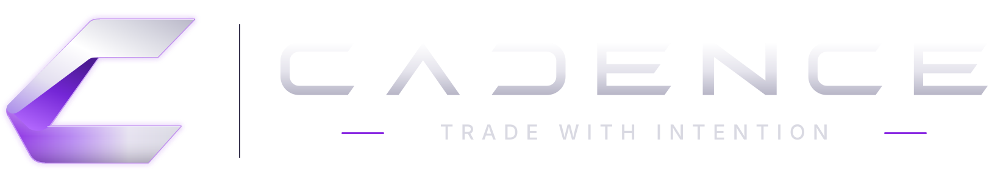

<p align="center">
  
</p>

# CADENCE

**An AI-powered futures trading journal — trade with intention.**

CADENCE turns a screenshot of a trade into a journaled, analysed trade in under a minute: Claude reads TradingView or platform screenshots, you confirm what it saw, a tap-only check-in captures the psychology, and an AI review tells you what to keep and what to fix. Built for CME futures traders funded through Lucid Trading.

- **Dashboard**: net P&L, win rate, profit factor, average R, average winner and loser, max drawdown, streaks, winning and losing days, average duration, expectancy. Charts: equity curve, daily/weekly/monthly P&L, win/loss split, long vs short, instruments, recent trades.
- **AI screenshot analysis**: upload up to 6 screenshots of one trade. Each field (instrument, contract, direction, entry/exit/stop/target, size, times, P&L, fees, risk, setup, timeframe, bias, structure and ICT concepts) comes back with a confidence level and a source: visible, inferred or missing. Uncertain fields are highlighted for you to confirm, and missing values are never invented.
- **Smart journaling**: nine tap-only questions (emotions before, during and after the trade, rule compliance, entry and exit quality, mistakes, setup quality, main lesson). They auto-advance and skip optional steps, so a trade takes 30–60 seconds. An AI review follows.
- **Journal**: search, filters, sorting, detail pages, edit, duplicate, delete with undo, and screenshot galleries.
- **Analytics**: date-range, account, instrument and direction filters. Breakdowns by session, weekday, hour, setup and instrument, plus psychology vs profitability. An **AI Performance Coach** only reports statistically supported patterns.
- **Lucid accounts**: rules you configure yourself (static or trailing drawdown, daily loss limit, targets, payout target, consistency, personal limits). CADENCE shows equity, drawdown utilization, remaining risk and progress, and labels the rules as user-provided or verified by you.
- **Calendar**: monthly P&L heat-map with weekly totals; tap a day to see its trades or mark it as a no-trade day.
- **Evening reminders**: Web Push at 8:30 PM local time by default, sent only when today's journal is incomplete.
- **PWA**: installable on iPhone, standalone, offline-capable, local-first with cloud sync.

---

## Architecture

```
Browser / installed PWA                                    Server (Next.js route handlers)
┌──────────────────────────────────────────┐              ┌───────────────────────────────────────────┐
│ Next.js App Router · React 19 · Tailwind │   NDJSON     │ /api/ai/analyze  Claude vision → schema    │
│ Framer Motion (motion) · Recharts        │◀────────────▶│ /api/ai/review   trade + journal → review  │
│                                          │  Bearer JWT  │ /api/ai/coach    aggregated stats → coach  │
│ Domain (pure TS): contract specs, P&L,   │              │ /api/push/*      Web Push subscriptions    │
│   sessions, stats, coach, Lucid rules    │              │ /api/cron/reminders  8:30 PM reminder job  │
│                                          │              │ /api/config      feature flags (no secrets)│
│ Local-first store: IndexedDB (Dexie)     │              └──────────────┬────────────────────────────┘
│   └─ sync engine ──────────────────────────────────────┐               │ service role (cron only)
│ Service worker: offline shell + push     │             ▼               ▼
└──────────────────────────────────────────┘     ┌───────────────────────────────────────┐
                                                 │ Supabase: Auth · Postgres (RLS) ·     │
                                                 │ Storage bucket "screenshots"          │
                                                 └───────────────────────────────────────┘
```

**Local-first data.** Every write lands in IndexedDB first, so the app is instant and works offline. When signed in, the sync engine (`src/lib/data/sync.ts`) pushes changed rows to Supabase and pulls rows changed on other devices using a server-assigned `server_updated_at` cursor. Conflicts resolve last-write-wins on the client edit time, and a database trigger enforces that rule again on the server. Deletes are soft (tombstones), so they propagate. Screenshots are cached on the device and stored in a private Storage bucket, one folder per user.

**Two modes.**

| | Cloud mode | Device-only mode |
|---|---|---|
| Enabled by | `NEXT_PUBLIC_SUPABASE_URL` + anon key | leaving them empty |
| Accounts | email + password or 6-digit email code | none |
| Storage | IndexedDB + Supabase (synced) | IndexedDB on this device |
| AI | for signed-in users | only with `CADENCE_AI_ALLOW_ANONYMOUS=true` (private deployments) |
| Push reminders (app closed) | yes | in-app reminders only |

Users can also choose “Continue without an account” in cloud mode. When they sign in later, their device records are adopted into the account.

**AI.** All model calls run server-side with the official Anthropic SDK (`src/lib/ai/server.ts`). Requests stream, use structured outputs (zod schemas in `src/lib/ai/schema.ts`), validate the JSON again on the server, and enable server-side refusal fallbacks (`fallbacks: "default"`). The API key never reaches the browser. The default model is `claude-opus-5-5` (override with `CADENCE_AI_MODEL`).

Extraction results then pass through deterministic checks (`src/lib/ai/postprocess.ts`):

- direction vs. stop/target geometry, with automatic swap detection;
- tick-grid checks against the contract spec;
- sanity limits on position size;
- chart time-zone conversion, with assumed dates flagged;
- commissions accepted only when visibly displayed.

The coach receives **aggregated statistics only** (no notes or screenshots). The server refuses to run it below 20 trades and drops any pattern with fewer than 8 samples.

**Calculations** (`src/lib/domain`): P&L = price move × (tick value ÷ tick size) × contracts, using CME specifications for ES, NQ, MES, MNQ, RTY, M2K, YM, MYM, CL and GC, plus MCL, MGC, SI, NG, 6E and ZN. You can add custom instruments. Commissions are **never assumed**. They come from the trade (when entered or visible on a screenshot), or from the per-instrument rate you set, or they are marked “not recorded”. Sessions use New York time with DST, and the trading day rolls at 18:00 ET (the CME convention).

### Project layout

```
src/app/(app)/        Dashboard, journal, trade (detail/edit), analyze, analytics, calendar, accounts, settings, brand
src/app/api/          AI, push, cron and config route handlers
src/components/       brand (logo system), ui (design system), charts, trades, journal, shell
src/lib/domain/       pure logic + unit tests (calc, stats, coach, accounts, reminders, csv, validation)
src/lib/ai/           schemas, prompts, server helpers, client, post-processing (+ tests)
src/lib/data/         IndexedDB schema, repository hooks, sync engine, backup, image handling
src/lib/brand/        logo geometry — single source for every SVG/PNG asset
supabase/migrations/  schema, RLS policies, storage bucket + policies
supabase/tests/       RLS test suite (runs on plain PostgreSQL)
scripts/              brand asset generator, VAPID key generator, RLS test runner
e2e/                  Playwright end-to-end suite with an Anthropic API mock
```

---

## Required keys and services

| Service | Needed for | Variables |
|---|---|---|
| **Supabase** (free tier works) | accounts, sync, screenshot storage, push reminders | `NEXT_PUBLIC_SUPABASE_URL`, `NEXT_PUBLIC_SUPABASE_ANON_KEY`, `SUPABASE_SERVICE_ROLE_KEY` (server only) |
| **Anthropic API** | screenshot analysis, AI reviews, coach | `ANTHROPIC_API_KEY` (server only), optional `CADENCE_AI_MODEL` |
| **VAPID key pair** | Web Push reminders | `NEXT_PUBLIC_VAPID_PUBLIC_KEY`, `VAPID_PRIVATE_KEY`, `VAPID_SUBJECT` — generate with `npm run vapid` |
| **Scheduler** | firing the reminder job every 15 min | `CRON_SECRET` |

Everything is optional: without any keys CADENCE runs fully in device-only mode, and you can still enter trades manually. See `.env.example`.

## Setup

```bash
npm install
cp .env.example .env.local      # fill in what you have
npm run dev                     # http://localhost:3000
```

### Supabase

1. Create a project and run `supabase/migrations/20261123000000_cadence_schema.sql`, either in the SQL editor or with `supabase db push`. It creates the tables, row-level security policies, sync triggers, and the private `screenshots` bucket with per-user folder policies.
2. **Auth → Providers → Email**: enable email sign-in.
3. **Auth → Email templates → Magic Link**: include `{{ .Token }}` so emails contain a 6-digit code. Codes work inside the installed iPhone app; links would open in Safari, which doesn't share the app's session.
4. **Auth → URL configuration**: set the Site URL to your deployment.

### Reminders (Web Push)

1. Run `npm run vapid` and put the keys in the environment.
2. Set `SUPABASE_SERVICE_ROLE_KEY` and `CRON_SECRET`.
3. Call `GET /api/cron/reminders` with `Authorization: Bearer $CRON_SECRET` every 15–30 minutes. Free options: [cron-job.org](https://cron-job.org) or Supabase `pg_cron` + `pg_net`. On a paid Vercel plan you can add a `vercel.json` with `{"crons": [{"path": "/api/cron/reminders", "schedule": "*/15 * * * *"}]}`. Vercel's free Hobby plan only allows daily crons and rejects the deployment otherwise, so no `vercel.json` ships by default.

The job checks each subscribed user's local time and sends at most one reminder per day. It only sends when today has unjournaled trades, or when no trades and no “no-trade day” mark exist on a weekday.

**iPhone:** Web Push requires iOS 16.4+ **and** CADENCE added to the Home Screen. In Safari, tap Share → Add to Home Screen, open the app from the icon, then go to Settings → Evening reminder → Enable. Permission must be granted from a tap, which CADENCE handles. Without server push, the in-app scheduler reminds you while CADENCE is open or in the background.

### Deploy (Vercel)

Import the repo, add the environment variables, and deploy. Set `NEXT_PUBLIC_SITE_URL` to your domain for correct social previews. Any Node host that runs `next start` works.

## Testing

```bash
npm run typecheck   # TypeScript
npm test            # unit tests: contract-spec P&L for all core contracts, fees, sessions/DST,
                    # stats, Lucid drawdown rules, reminders, coach significance, CSV, AI post-processing
npm run test:rls    # migration + row-level security on a throwaway local PostgreSQL
npm run build && npm run test:e2e   # Playwright e2e against the production build (Anthropic API mocked)
```

The e2e suite covers:

- navigation and accounts;
- manual entry with live calculation, editing, duplicating, and deleting with undo;
- search, filters and sorting;
- the full AI flow (streamed progress, confidence review, questionnaire, AI review);
- dashboard metrics, calendar, CSV export, backup and restore;
- analytics tabs and the coach (with small-sample filtering);
- in-app reminders, PWA assets, offline reloads, mobile layouts and console errors.

## Brand

The logo system is generated from `src/lib/brand/geometry.ts`, a vector trace of the brand board (`design/cadence-brand-board.png`). `npm run icons` rebuilds:

- the primary lockup (dark and light);
- the standalone symbol in dark, light, monochrome, small and outline variants;
- the wordmark;
- app icons (dark, light, mono, violet, outline), the maskable icon, the Apple touch icon, favicons and the social preview image.

You can view everything in the app at **Settings → Brand & logo assets** (`/brand`).

Palette: Obsidian `#0B0B0F` · Deep Purple `#1A1028` · Electric Purple `#8A2BE2` · Bright Violet `#B46AFF` · Chrome Silver `#D9D9E2`. Type: Sora (display), Inter (UI), JetBrains Mono (numbers).

## Honest limitations

- **No broker integration.** Lucid Trading and its platforms offer no supported public API that CADENCE connects to. Trades come from screenshots, manual entry or backups. Account balances are calculated from your journal, and you can reconcile them against your platform.
- **Lucid rules are not hardcoded.** You enter them. They stay labelled “user-provided” until you mark them as checked against Lucid's official documentation (with date and source).
- **AI extraction can misread.** That's why every field shows its confidence and source and has to be confirmed before saving. Extraction quality depends on screenshot clarity.
- **Rate limiting** in the AI routes is in-memory per server instance. Put an edge rate limiter in front for high-traffic deployments.
- **iOS app.** CADENCE is a PWA today and is **not** published on the App Store. The architecture is ready for a native shell: the domain logic, sync engine and API are UI-agnostic, so the planned path is a Capacitor iOS wrapper, with native push via APNs replacing Web Push.
- Reminder “today” uses your local calendar day, while statistics use the CME trading day (which rolls at 18:00 ET).
